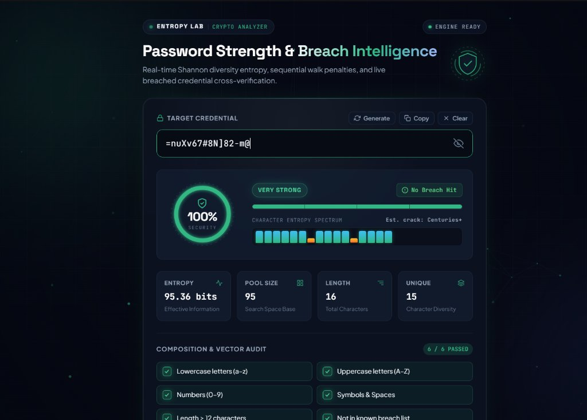

# Entropy Lab — Password Strength & Breach Intelligence

A minimalist, high-performance password security analyzer that combines **information entropy** (with incremental surprise calculation and pattern penalties) and a **breached password database** to calculate an accurate security percentage, crack-time estimate, and per-character entropy spectrum.

Built with a **Python** backend (Vercel Serverless Function & FastAPI), a **Rust** cryptographic module, and an animated glassmorphic **HTML/CSS/JS** interface featuring custom vector graphics and zero emojis.

**Live Demo:** https://password-strength-checker-ruddy-nu.vercel.app

---

## Screenshots & UI Preview

The interface dynamically adapts its color palette, radial gauge, ambient constellation canvas, and vector shield icon in real time based on the password's calculated security tier.

### Very Strong Credential (100% Security)
High-entropy 16-character generated credential using the full 95-character search space (`95.36 bits`, `6/6` audit checks passed, estimated offline crack time `Centuries+`).



### Medium Credential (58% Security)
13-character alphanumeric password (`49.33 bits`, `5/6` audit checks passed, estimated crack time `19.7 hours`). The **Character Entropy Spectrum** highlights repeated and low-information characters in amber/red while unique high-entropy positions glow teal.


### Very Weak Credential (16% Security)
Short lowercase-only input (`14.10 bits`, `2/6` audit checks passed, estimated crack time `Instant`). The entire UI shifts to a crimson alert state with a warning vector shield and danger meter.


---

## Key Features

1. **Information Entropy**:
   - Computes search-space pool size based on character classes (lowercase, uppercase, numbers, symbols, spaces, Unicode).
   - **Zero Entropy for Repetitions**: Typing repeated identical letters (e.g. `aa`, `aaa`, `aaaaaaaa`) contributes **0 additional bits of entropy**.
   - Keyboard sequence walks (e.g. `1234`, `abcd`, `qwerty`) are penalized.
2. **Breach / Leak Database Integration**:
   - Cross-references passwords against high-frequency leaked credential lists via `/api/check`.
   - **Crucial Rule**: Any password found in a breach list immediately drops to **0% Score** and is marked as **Compromised**, regardless of character count or raw entropy.
3. **Interactive Animated UI & Custom Graphics**:
   - **Preloader Intro Sequence**: Animated hexagonal cryptographic shield with orbital rings, laser scanline, and telemetry boot bar before page reveal.
   - **Reactive Constellation Canvas**: Cursor-interactive particle network whose hue dynamically morphs with password strength.
   - **Radial Entropy Gauge & Character Spectrum**: Circular SVG progress arc with a morphing vector shield icon, per-character entropy bar visualizer, and offline crack-time estimator.
   - **Built-in Controls**: Cryptographic 16-character password generator (`crypto.getRandomValues`), one-click copy, visibility toggle, and animated composition audit checklist.
4. **Vercel Deployable**:
   - Zero-config static CDN serving from `public/` paired with a native Python FastAPI serverless function at `/api/check`.

---

## Project Structure

```
password-strength-checker/
├── .gitignore                 # Standard Python, Rust, and Vercel gitignore
├── README.md                  # Project documentation
├── requirements.txt           # Python dependencies for Vercel
├── vercel.json                # Vercel serverless rewrite configuration
├── common_passwords.txt       # Breached credentials dataset
├── test_algorithm.py          # Extreme cases verification script
│
├── api/                       # Vercel Serverless Functions
│   ├── check.py               # FastAPI serverless handler
│   └── common_passwords.txt   # Bundled breach dataset
│
├── assets/                    # Documentation Media
│   └── screenshots/           # UI preview screenshots
│       ├── very-strong.jpg
│       ├── medium.jpg
│       └── very-weak.jpg
│
├── backend/                   # Local Development Server
│   ├── app.py                 # FastAPI local server
│   └── requirements.txt
│
├── frontend/                  # Rust Module
│   ├── Cargo.toml             # Rust package configuration
│   └── src/
│       └── lib.rs             # Rust entropy & verification engine
│
├── public/                    # Production Static Assets (Vercel CDN)
│   ├── index.html
│   ├── style.css
│   └── app.js
│
├── index.html                 # Root static fallback
├── style.css
└── app.js
```

---

## Algorithm & Extreme Cases

The algorithm evaluates information entropy incrementally:

$$\text{First Character: } E = \log_2(R)$$
$$\text{Consecutive Identical Character: } \Delta E = 0.00\text{ bits}$$
$$\text{Sequential Step: } \Delta E \le 1.50\text{ bits}$$
$$\text{New Unique Character: } \Delta E = \log_2(R)\text{ bits}$$

### Extreme Cases Verified

| Password Description | Input | Entropy | Score % | Level | Status |
| :--- | :--- | :---: | :---: | :---: | :--- |
| Empty password | `""` | 0.00 b | 0% | Very Weak | Normal |
| Single char | `"a"` | 4.70 b | 5% | Very Weak | Normal |
| Two repeated letters | `"aa"` | 4.70 b | 5% | Very Weak | Repetition: 0 bits |
| Five repeated letters | `"aaaaa"` | 4.70 b | 5% | Very Weak | Repetition: 0 bits |
| 20 identical characters | `"aaaaaaaaaaaaaaaaaaaa"` | 4.70 b | 5% | Very Weak | Repetition: 0 bits |
| 10 identical numbers | `"1111111111"` | 3.32 b | 3% | Very Weak | Repetition: 0 bits |
| Leaked numeric sequence | `"123456"` | 7.47 b | **0%** | **Compromised** | Found in breach list |
| Leaked dictionary word | `"password"` | 32.90 b | **0%** | **Compromised** | Found in breach list |
| 10-digit sequence | `"1234567890"` | 13.29 b | 15% | Very Weak | Sequence penalized |
| 10-letter alphabet run | `"abcdefghij"` | 15.28 b | 17% | Very Weak | Sequence penalized |
| 2-character alternating cycle | `"ababababab"` | 12.51 b | 14% | Very Weak | Low variety |
| Short 4-char full pool | `"Aa1!"` | 26.28 b | 30% | Weak | Length penalty |
| XKCD famous example | `"Tr0ub4dor&3"` | 67.58 b | 79% | Strong | Normal |
| Common leetspeak pattern | `"P@ssw0rd2026"` | 62.88 b | 73% | Medium | Normal |
| Long 4-word passphrase | `"correct horse battery staple"` | 68.69 b | 80% | Strong | Passphrase |
| 16-char random complex | `"k9#mQ$8vL!2xZ@5w"` | 105.12 b | 100% | Very Strong | High entropy |
| Unicode with special glyph | `"español★123"` | 60.68 b | 71% | Medium | Handled |

---

## Local Development

### 1. Test Extreme Cases
```bash
python test_algorithm.py
```

### 2. Run Local Backend (FastAPI)
```bash
cd backend
python -m venv venv
# Windows:
venv\Scripts\activate
# Mac/Linux:
# source venv/bin/activate
pip install -r requirements.txt
uvicorn app:app --reload --port 8000
```

### 3. Open Frontend
Open `index.html` in your browser (or use Python's built-in HTTP server: `python -m http.server 3000`).

---

## Deploy to Vercel

```bash
git add .
git commit -m "Fresh clean rebuild: complete entropy engine, breach detector, and clean UI"
git push origin main --force
```

Vercel will detect the push and automatically deploy both the static frontend and the serverless Python API.
